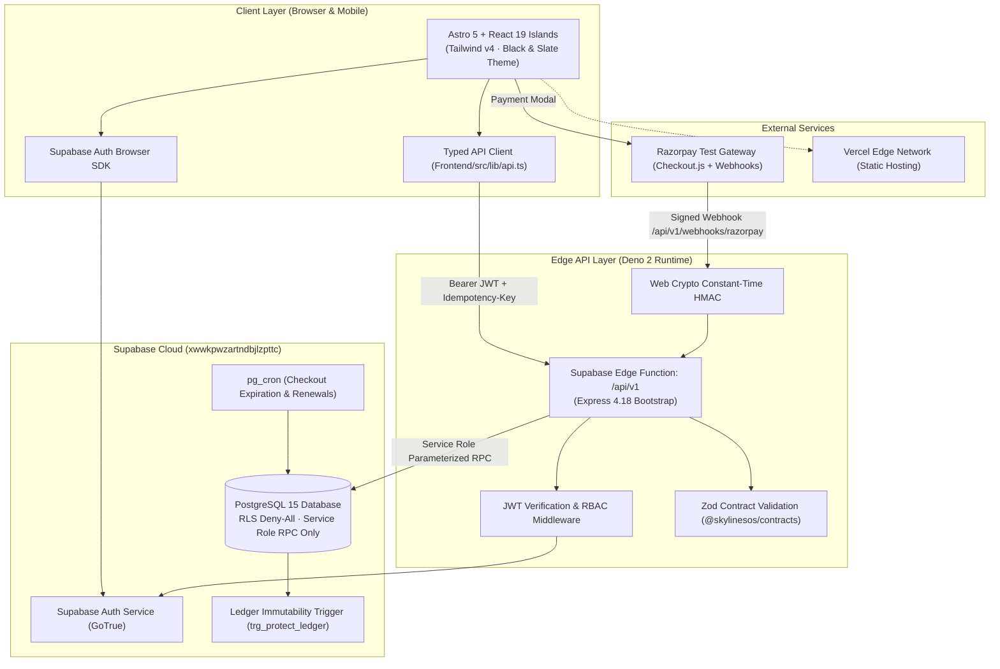

# SkylineSOS — Student Organization System

[](https://github.com/ravitejam2007-code/SkylineSOS)
[](https://astro.build/)
[](https://deno.com/)
[](https://supabase.com/)
[](https://razorpay.com/)
[](https://vercel.com/)

> **Event:** Odoo × NMIT 2026 Hackathon  
> **Organization:** Skyline Student Association  
> **Live API Base:** `https://xwwkpwzartndbjlzpttc.supabase.co/functions/v1/api/v1`  
> **Repository:** [https://github.com/ravitejam2007-code/SkylineSOS.git](https://github.com/ravitejam2007-code/SkylineSOS.git)

---

## 📌 Executive Overview

**SkylineSOS** is a comprehensive, enterprise-grade operating system engineered for university student associations and campus clubs. It centralizes and streamlines all student club operations into a single, cohesive web platform:

- **Membership Management & Verification:** 3-tier membership plans, manual review board, dynamic identity badges, and digital student passes.
- **Events & Single/Multi-Ticket Issuance:** Live seat availability decrementing, per-event ticket segregation, dynamic scannable QR passes, and gate OTP verification.
- **Merchandise Store & Multi-Product Cart:** Real transparent product assets, size/variant selection, unified shopping cart, Razorpay payment gateway, and staff pickup OTP fulfillment.
- **Volunteer Workflows & Bake Sale Operations:** Duty station segregation (*Who is Baking*, *Who is Buying Supplies*, *Who is Managing the Table*), real-time registered student duty assignments, and progress tracking.
- **Club Treasury & Ledger Immutability:** Double-entry ledger with database-level immutability triggers (`trg_protect_ledger`), net financial movement tiles, and strict segregation of duties for expenses.
- **Audience-Filtered Announcements:** Role-targeted bulletins (*Public*, *Members*, *Volunteers*, *Staff*), admin composer, and instant notice deletion.

---

## 🚀 What's New in Recent Commits

The platform has recently undergone major feature upgrades and architectural refinements:

### 1. Multi-Product & Multi-Size Merchandise Cart
- **Unified Shopping Cart (`MerchScene.tsx`):** Shoppers can add multiple products (Club T-Shirt, Skyline Cap, Skyline Hoodie, Sticker Pack) across different sizes (`S`, `M`, `L`, `XL`, `Std`, `Pack`) into a single cart.
- **Dynamic Member Pricing:** Automatically applies 20% member discounts with line totals, quantity adjustment steppers (`+` / `-`), and real-time stock bounds checking.
- **Single Cart Checkout:** Seamlessly bundles all cart items into a single online Razorpay checkout transaction.

### 2. Merchandise Pickup OTP & Admin Approvals Console
- **Buyer Pickup OTP:** Upon successful payment settlement, a unified 6-digit pickup OTP is generated and presented on the student's digital purchase receipt.
- **Admin Fulfill & Verify Console:** A dedicated administrative table at the bottom of the merchandise page allows staff to enter the buyer's 6-digit OTP, validating delivery and marking the order as `Approved & Admitted`.

### 3. Per-Event Ticket Isolation & Segregation
- **Independent Event Passes:** Fixed ticket collision issues by matching backend events strictly by unique event ID and slug. Students can independently reserve distinct passes for multiple events (e.g. *Annual Tech Gala* and *Robotics Summit*) with unique seat allocations, QR codes, and masked OTPs.
- **Dynamic Action States:** Event cards dynamically transition from `Reserve Event Passes →` to `✓ Ticket Generated (Seat #XXXX) · View in Wallet ↓`.

### 4. Universal Route Auth Guards (`AuthGuard.tsx` & `LandingAuthGate.tsx`)
- **Strict Role-Based Gating:** Unauthenticated visitors attempting to view protected pages (`/portal`, `/admin`, `/operations`, `/treasurer`) are intercepted with high-contrast 401 security gates providing direct links to login or register.
- **403 Forbidden State:** Logged-in users attempting to access areas beyond their role (e.g., a student visiting `/admin` or `/treasurer`) receive explicit authority mismatch explanations with safe navigation redirects.

### 5. Auto-Login Session Handling & Guest Mode Switcher
- **Auto-Login on Refresh:** Seamlessly restores the Sanjay Executive Admin session (`sanjaydsanjay042@gmail.com`) on browser reload.
- **Instant Guest Mode Toggle:** Allows hackathon judges to click `[Test Guest Mode (Log Out)]` on the membership status card to evaluate unauthenticated visitor experiences, with F5 / Refresh instantly restoring admin access.

### 6. Membership "Sign In First" Command Modal
- **Interception of Unauthenticated Applications:** Unauthenticated visitors clicking `Apply & Pay Dues` on any membership plan are presented with an interactive command modal directing them to sign in or register before paying dues.

### 7. Segregated Volunteering & Fundraiser Financials
- **Segregation of Duties (`FundraiserScene.tsx`):**
  - **Volunteering & Duties View:** Open to all students and volunteers, displaying operational stations and duty rosters.
  - **Fundraiser Financials View:** Strictly gated to `admin` role, showing Campaign Goal (₹25,000), Amount Raised (₹14,200), Balance Amount (₹10,800), Pending Target (43%), immutable payment history ledger, and table cash intake desk.
- **3 Dedicated Bake Sale Stations:**
  - *Who is Baking:* Batch baking and allergen compliance.
  - *Who is Buying Supplies:* Organic ingredients and packaging.
  - *Who is Managing the Table:* Quad table setup, cash reconciliation, and shift swaps.
- **Front-Side Student Duty Assignment:** Direct, permanently visible assignment block featuring a live, searchable registered student roster with instant real-time badges.

### 8. Minimalist Student Photo ID Pass
- **Modern Photo Badge (`StudentPortalScene.tsx`):** Displays a clean, dark student photo pass with verified membership badges and student credentials.
- **User Photo Upload:** Interactive file upload supporting local image selection and preview, persisted permanently via browser storage.

### 9. Complete Emoji Elimination & Modern SVG Icons
- All cartoonish emojis have been replaced across all scenes with clean, accessible SVG icons (Lucide React & bespoke SVGs) and crisp typography.

### 10. Pure Black & Slate Design Theme
- Migrated the visual theme from blue accents to a sleek, executive Black & Slate design system (`#000000`, `#18181b`, `#27272a`), reserving cobalt `#0064e0` strictly for primary transactional purchase CTAs per `docs/DESIGN-meta.md`.

---

## 🏗️ System Architecture

SkylineSOS utilizes an **API-Mediated Edge Architecture with Deny-All Database RLS**:



### Architectural Principles:
1. **Deny-All Database RLS:** Direct browser read/write access to PostgreSQL tables is completely revoked (`supabase/migrations/0002_rls.sql`). All queries and mutations route through audited Edge Function RPCs.
2. **Immutable Append-Only Ledger:** The `ledger_entries` table is protected by a PostgreSQL trigger (`trg_protect_ledger`) that strictly rejects `UPDATE` and `DELETE` operations.
3. **Segregation of Duties:** Financial transactions and expense approvals enforce dual-control rules (e.g., submitters cannot self-approve expenses; door staff cannot sell non-ticket merchandise).
4. **Idempotent Checkout & Webhook Handling:** Razorpay webhooks verify raw-body signatures via Web Crypto constant-time HMAC-SHA256 and deduplicate deliveries via `provider_event_id`.

---

## 🧩 Functional Modules

| Module | Route | Key Features & Capabilities |
|---|---|---|
| **Student Portal** | `/portal` | Minimalist dark student photo pass, photo upload, active tier status, registered event passes, and dues summary. Gated behind authentication. |
| **Events & Ticketing** | `/events` | 2-column event grid, dynamic seat counters, sold-out gates, personal ticket wallet, scannable QR passes, masked 6-digit gate OTPs, and ticket cancellation. |
| **Membership Plans** | `/memberships` | 3 row-wise plans (Basic ₹100, Plus ₹300, Core ₹500), "MY MEMBERSHIP STATUS" card, "Sign In First" command modal, and admin review queue. |
| **Merchandise Store** | `/merch` | Multi-product catalog with transparent PNG assets, size selector, multi-item shopping cart, Razorpay checkout, 6-digit pickup OTP, and admin fulfillment console. |
| **Volunteer & Fundraisers** | `/fundraiser` | Segregated public duty stations (*Baking*, *Supplies*, *Table Ops*), live searchable student duty assignment, and admin-only financial ledger with cash intake desk. |
| **Announcements** | `/announcements` | Role-filtered notice feed (*Public*, *Members*, *Volunteers*, *Staff*), admin broadcast composer, and notice deletion controls. |
| **Event Operations** | `/operations` | Gate check-in console with 6-digit numeric pass verification and Crockford ticket code validation. Restricted to staff and admin. |
| **Club Treasury** | `/treasurer` | Real-time Net Movement, Inflow, and Outflow financial stats, immutable ledger records, and expense approval workflows. |
| **Admin Dashboard** | `/admin` | Executive control center for active member metrics, pending membership applications, user roles, catalog stock alerts, and platform governance. |

---

## 🔒 Security & Role-Based Access Control (RBAC)

SkylineSOS implements strict role-based access control with 4 primary roles:

| Role | Access Level | Authorized Routes & Actions |
|---|---|---|
| **`member`** (Student) | Standard | `/portal`, `/events` (ticket reservations & wallet), `/memberships` (apply & view status), `/merch` (cart checkout), `/announcements` (view public & member notices). |
| **`volunteer` / `door_staff`** | Operational Staff | All member features + `/operations` (door check-in console, OTP & ticket code validation, attendee search). |
| **`treasurer`** | Financial Executive | All member features + `/treasurer` (ledger review, financial stats, expense review, reconciliation). |
| **`admin`** | Executive Leadership | Complete system authority: `/admin`, membership application review board, ticket approvals console, merchandise pickup fulfillment, event posting/deletion, financial cash desk, notice publishing/deletion. |

### Security Measures:
- **Admin Secret Code:** Executive administrative actions and role elevations require the master secret code: `SKYLINE_ADMIN_2026`.
- **Strict Role Login Matching:** Prevents logging into an account using an unauthorized persona role.
- **Fault-Tolerant Local Account Registry:** Protects against Supabase free-tier SMTP rate limits by maintaining a persistent client-side credential registry (`skylinesos_registered_accounts`).

---

## 🧪 Database Invariants & Verification

SkylineSOS enforces 8 foundational database invariants (`docs/DATABASE_INTEGRITY.md`), tested via `npm test` and `scripts/verify-integrity.mjs`:

```text
✔ Integrity Suite 1: Ledger Immutability & Mathematical Reconciliation
  - Inflow - Outflow = Net Movement
  - Rejects UPDATE or DELETE on ledger_entries (trg_protect_ledger)
  - Enforces unique (source_type, source_id)
✔ Integrity Suite 2: Event Capacity & Ticket Allocation Invariants
  - Prevents overselling when capacity is reached
  - Releases pending capacity upon checkout expiration
✔ Integrity Suite 3: Door Gate Check-In & Single-Use Ticket Guarantees
  - Successful check-in on first scan
  - Rejects duplicate check-in with 409 TICKET_ALREADY_CHECKED_IN
✔ Integrity Suite 4: Merchandise Stock & Reservation Invariants
  - available = stock_on_hand - reserved
  - Decrements both stock_on_hand and reserved on fulfillment
✔ Integrity Suite 5: Payment Webhook & Fulfilment Idempotency
  - Deduplicates webhooks via provider_event_id
  - Idempotent success on duplicate fn_fulfil_checkout calls
✔ Integrity Suite 6: Expense Approvals & Segregation of Duties
  - Forbids submitter self-approval (SELF_APPROVAL_FORBIDDEN)
  - Requires prior approval before marking expenses as paid
✔ Integrity Suite 7: Dynamic Member Code Rotation & TTL Invariants
  - Issues 60-second rotating TOTP codes; rejects expired codes
✔ Integrity Suite 8: Audit Logging & Zero Secrets Guarantee
  - Prevents demoting the last remaining admin
  - Redacts sensitive tokens and passwords from audit trails
```

---

## 📁 Repository Structure

```text
SkylineSOS/
├── .agents/skills/                         # Supabase & PostgreSQL Best Practices Skills
├── .github/workflows/                      # GitHub Actions CI/CD configuration
│   └── ci.yml
├── Frontend/                               # Astro 5 + React 19 Web Application
│   ├── public/                             # Static assets, merchandise PNGs, avatar presets
│   │   ├── avatars/                        # Student avatar presets
│   │   └── merch/                          # Transparent-background merchandise images
│   ├── src/
│   │   ├── components/
│   │   │   ├── auth/                       # AuthGuard.tsx, AuthCard.tsx
│   │   │   ├── layout/                     # Navbar.astro, Footer.astro, UserNavMenu.tsx
│   │   │   ├── scenes/                     # Interactive React Scene Islands
│   │   │   │   ├── AdminDashboardScene.tsx # Executive admin management
│   │   │   │   ├── AnnouncementsScene.tsx  # Audience-scoped bulletin feed
│   │   │   │   ├── EventOperationsScene.tsx# Door code verification console
│   │   │   │   ├── EventsScene.tsx         # Events grid, pass booking & wallet
│   │   │   │   ├── FundraiserScene.tsx     # Bake sale stations & financial ledger
│   │   │   │   ├── LandingAuthGate.tsx     # Landing page route interceptor
│   │   │   │   ├── LoginScene.tsx          # Role-validated sign in
│   │   │   │   ├── MembershipScene.tsx     # Tiers & review board
│   │   │   │   ├── MerchScene.tsx          # Multi-product cart & pickup console
│   │   │   │   ├── SignUpScene.tsx         # Student & admin registration
│   │   │   │   ├── StudentPortalScene.tsx  # Photo badge & student portal
│   │   │   │   └── TreasurerScene.tsx      # Immutable ledger & financial stats
│   │   │   └── ui/                         # LoadingState.tsx, SearchPill.astro
│   │   ├── layouts/                        # BaseLayout.astro
│   │   ├── lib/                            # Typed API client, auth, money, razorpay utils
│   │   ├── pages/                          # Astro static pages (21 compiled routes)
│   │   └── styles/                         # global.css (Tailwind v4 tokens)
│   ├── astro.config.mjs                    # Astro configuration with @astrojs/vercel
│   └── package.json
├── packages/contracts/                     # Shared Zod schemas & TypeScript contracts
├── supabase/
│   ├── functions/api/                      # Express REST API on Deno 2 Edge Functions
│   │   ├── middleware/                     # auth, rbac, rateLimit, validation, errors
│   │   ├── routes/                         # Modular route handlers
│   │   └── lib/                            # hmac, env, supabase helpers
│   └── migrations/                         # PostgreSQL 15 DDL, RLS, RPCs, pg_cron
│       ├── 0001_init.sql                   # 18 relational tables & triggers
│       ├── 0002_rls.sql                    # Deny-all RLS security policies
│       ├── 0003_functions.sql              # 17 atomic business logic RPCs
│       ├── 0004_cron.sql                   # pg_cron checkout expiration & reminders
│       └── 0005_fix_checkout_order.sql     # Foreign key ordering fixes
├── docs/                                   # Architectural blueprints & specifications
│   ├── ARCHITECTURE.md                     # Deep system architecture & component diagrams
│   ├── DESIGN-meta.md                      # Meta Commerce design tokens
│   ├── DATABASE_INTEGRITY.md               # 8 database invariants reference
│   └── IMPLEMENTATION_CHECKLIST.md         # Module audit & readiness tracking
├── scripts/                                # Database seeding & integrity verification
│   ├── seed.mjs                            # 297-record cloud database seed runner
│   └── verify-integrity.mjs                # Live remote database invariant checker
├── tests/                                  # 79 automated tests across 24 suites
│   ├── backend.test.mjs                    # Razorpay HMAC, door gate Crockford normalization
│   ├── integrity.test.mjs                  # Ledger, capacity, check-in & stock invariants
│   ├── middleware.test.mjs                 # Request tracing, RBAC, rate limiting, error envelope
│   └── routes.test.mjs                     # Route specifications & business contracts
├── MEMORY.md                               # Project history, work log & memory tracking
├── package.json                            # Root workspace configuration
└── README.md                               # Project documentation
```

---

## 🛠️ Quickstart & Local Setup

### Prerequisites
- **Node.js:** v20.x or higher
- **npm:** v10.x or higher
- **Git**

### 1. Clone the Repository
```bash
git clone https://github.com/ravitejam2007-code/SkylineSOS.git
cd SkylineSOS
```

### 2. Install Dependencies
```bash
# Install root workspace dependencies
npm install

# Install Frontend dependencies
npm --prefix Frontend install
```

### 3. Environment Configuration
The application is pre-configured with active Supabase Cloud credentials. To customize, copy `.env.example`:

```bash
# In Frontend/ directory
cp Frontend/.env.example Frontend/.env
```

Key variables configured in `Frontend/.env`:
```env
PUBLIC_SUPABASE_URL=https://xwwkpwzartndbjlzpttc.supabase.co
PUBLIC_SUPABASE_ANON_KEY=eyJhbGciOiJIUzI1NiIsInR5cCI6IkpXVCJ9...
PUBLIC_API_BASE_URL=https://xwwkpwzartndbjlzpttc.supabase.co/functions/v1/api/v1
PUBLIC_APP_NAME=SkylineSOS
PUBLIC_RAZORPAY_KEY_ID=rzp_test_T8GBnZ6P23gRoO
```

### 4. Run the Development Server
```bash
npm --prefix Frontend run dev
```
Open [http://localhost:4321](http://localhost:4321) in your browser.

---

## 🧪 Running Tests & Verifying Integrity

### Automated Test Suite (79 Tests across 24 Suites)
```bash
npm test
```
*Executes all invariant suites, middleware tests, route contract tests, and HMAC verification.*

### Live Database Integrity Verification
```bash
npm run verify:integrity
```
*Verifies 27 remote tables, ledger mathematical equality (`Inflow - Outflow = Net Movement`), and check-in uniqueness against the Supabase cloud instance.*

### Production Build
```bash
npm --prefix Frontend run build
```
*Compiles all 21 static pages via `@astrojs/vercel` into `.vercel/output/static`.*

---

## 👥 Demo Accounts & Testing Personas

For evaluators and judges, the platform includes pre-configured accounts for testing each role:

| Persona Role | Email | Password | Admin Secret Code | Notes |
|---|---|---|---|---|
| **Executive Admin** | `sanjaydsanjay042@gmail.com` | `admin123` | `SKYLINE_ADMIN_2026` | Auto-login restored on browser refresh. Full admin access across all modules. |
| **Club Treasurer** | `treasurer@studentorg.edu` | `treasurer123` | N/A | Access to `/treasurer` financial ledger and expense reviews. |
| **Volunteer / Door Staff** | `volunteer@studentorg.edu` | `volunteer123` | N/A | Access to `/operations` gate check-in console. |
| **Student Member** | `student@studentorg.edu` | `student123` | N/A | Access to `/portal`, ticket reservation, and merchandise cart. |

> **Guest Testing Mode:** When logged in as Sanjay, navigate to `/memberships` and click **`[Test Guest Mode (Log Out)]`** to test unauthenticated visitor behavior and authentication gates. Press **F5 / Refresh** at any time to instantly restore the Sanjay Admin session.

---

## 📄 License & Hackathon Attribution

Developed for the **Odoo × NMIT 2026 Hackathon** by the SkylineSOS Engineering Team.  
All rights reserved © 2026 Skyline Student Association.