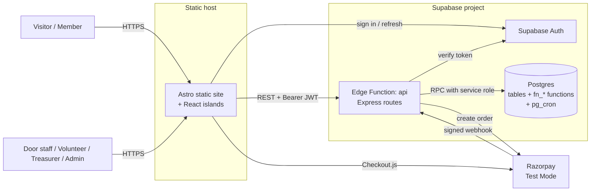
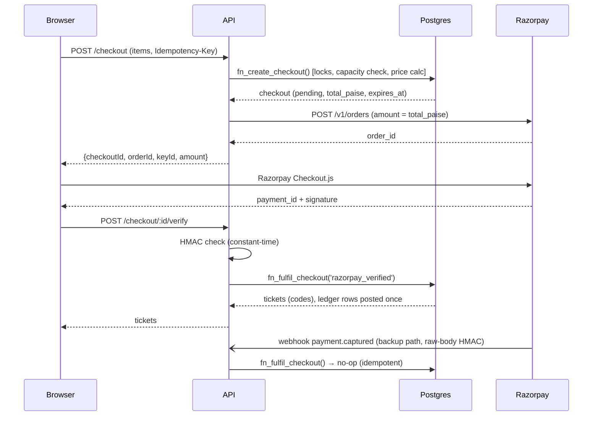
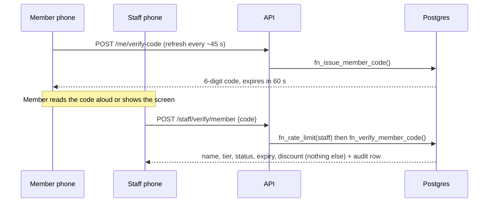
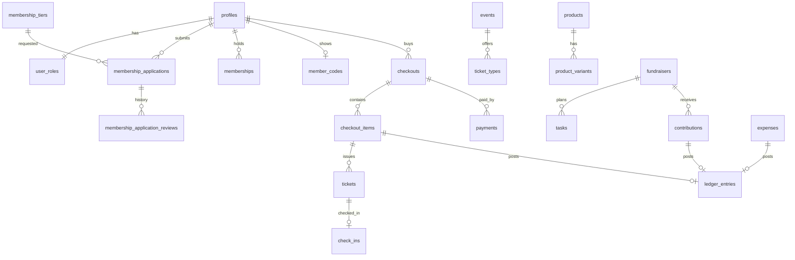

# SkylineSOS — System Architecture

| | |
|---|---|
| **Version** | 3.0 |
| **Date** | 10 October 2026 |
| **Goal** | The simplest architecture that is still secure, correct with money, and deployable entirely on Supabase |
| **Read with** | [TRD](./TRD.md) for detail · [API Docs](./api-docs.md) for contracts |

---

## 1. Architecture in one paragraph

A **static Astro website** talks to **one Express API** running as a **single Supabase Edge Function**. The API checks the user's Supabase Auth token, checks the user's role, then calls **Postgres functions** that perform each business operation atomically (checkout, fulfilment, check-in, ledger). The browser never reads or writes database tables directly. Razorpay Test Mode handles online payments; staff-recorded cash/UPI uses the same checkout path. Identity at the door is verified by **typed codes**, not QR scans.

## 2. System context



Everything inside the "Supabase project" box is hosted by Supabase. The static host serves files only.

## 3. Containers

| Container | Technology | Responsibility | Does NOT do |
|---|---|---|---|
| **Web** | Astro static + React islands + Tailwind v4 | UI, forms, client-side guards, calls API | Authorize anything; hold secrets; touch tables |
| **Auth** | Supabase Auth | Passwords, sessions, JWTs | Roles (kept in `user_roles`) |
| **API** | Express in Edge Function `api` | AuthN, RBAC, validation, rate limits, Razorpay calls, error mapping | Hold business invariants (delegated to SQL) |
| **Database** | Postgres | Source of truth; atomic functions; ledger; audit; cron | Serve the browser directly (RLS deny-all) |
| **Scheduler** | pg_cron | Expire pending checkouts; renewal reminders | Anything external |
| **Payments** | Razorpay Test | Order, capture, webhook | Fulfilment decisions (we decide, after verifying) |

## 4. Layering inside the API

```text
HTTP request
  → requestId → cors → body parser
  → authenticate (JWT → user + role)
  → requireRole
  → validate (zod)
  → rateLimit (DB-backed, sensitive routes only)
  → route handler  (≤ 40 lines: map request → one RPC → map response)
  → Postgres fn_* (transaction, row locks, constraints, audit)
  → errorHandler (RAISE EXCEPTION code → JSON envelope)
```

Rule of thumb: **if a rule must never be broken (stock ≥ 0, one check-in per ticket, one ledger row per source), it lives in the database.** If a rule is about *who may call* something, it lives in the API.

## 5. Key flows

### 5.1 Online ticket purchase (Razorpay Test)



### 5.2 Staff-recorded cash sale at the door

`POST /staff/checkout` → `fn_record_staff_checkout` (create + fulfil in one transaction, actor/method/note mandatory, audit row) → ticket code shown on the staff screen and in the buyer's account.

### 5.3 Door verification by code



Ticket check-in is the same shape with `POST /door/check-in {eventId, code}` → `fn_check_in` (row lock → single insert into `check_ins`).

### 5.4 Treasurer overview

`GET /treasurer/overview?from&to` → `fn_treasurer_overview` reads only `ledger_entries`. Each row carries `source_type/source_id`, so the UI links straight to the checkout item, contribution or expense.

## 6. Data architecture



Single source of financial truth: `ledger_entries` (insert-only, unique per source). Dashboards read it; nothing writes totals.

## 7. Security architecture

| Boundary | Control |
|---|---|
| Internet → static site | HTTPS, security headers (`_headers`: CSP, X-Content-Type-Options, Referrer-Policy, frame-ancestors) |
| Browser → API | Exact-origin CORS; bearer JWT; 100 kb body cap; Zod validation; rate limits on auth-adjacent, verify and checkout routes |
| API → Database | Service-role key held only as an Edge Function secret; every call is a parameterised RPC |
| Browser → Database | **Blocked**: RLS enabled everywhere, no policies, privileges revoked from `anon`/`authenticated`, functions not executable by them |
| Razorpay → API | Webhook signature over the raw body; event-ID dedupe |
| Data at rest | Supabase-managed encryption and backups; no card data stored |
| Audit | Cash/UPI entries, approvals, role grants, code verifications and check-ins are written to `audit_logs` |

**Threat table (top 8)**

| # | Threat | Control |
|---|---|---|
| T1 | Privilege escalation by editing a request | Role read from `user_roles` on every request; status/role fields never accepted from clients |
| T2 | Price tampering | Totals computed in `fn_create_checkout` from database prices |
| T3 | Fake payment confirmation | Signature verification; callback alone is not proof |
| T4 | Double spend / double fulfilment | Idempotency keys; status transitions under row locks; unique ledger source key |
| T5 | Oversell | Row locks + `CHECK (reserved <= stock_on_hand)` + capacity check in the same transaction |
| T6 | Code guessing | Random 40-bit ticket codes; 60 s member codes; staff-only; rate limit; audit |
| T7 | Secret leakage | `.env` only; secret scanning; service key never in the web bundle |
| T8 | Direct database access via public API | RLS deny-all + revoked grants (tested) |

## 8. Deployment topology

```text
GitHub ──push──► CI (lint, typecheck, build, tests)
   │
   ├── supabase db push ───────────► Postgres (migrations)
   ├── supabase functions deploy api ► Edge Function (Express)
   ├── supabase secrets set ────────► Function secrets (Razorpay, origin, TTLs)
   └── build apps/web ──► static host (Cloudflare Pages / Netlify / Vercel static)
```

One Supabase project, one static site, one Razorpay Test account. No staging environment during the hackathon; use a local `supabase start` stack for risky changes.

## 9. Failure modes and responses

| Failure | User impact | Response |
|---|---|---|
| Razorpay down or slow | Online checkout fails | Pending checkout expires and releases stock/seats in ≤ 15 min; staff use cash/UPI path |
| Webhook delayed | Payment captured, ticket missing | `verify` endpoint fulfils on the browser callback; webhook fulfils later idempotently |
| Edge Function cold start | First request slow (hundreds of ms) | Single function; optional `/health` ping |
| Wi-Fi poor at door | Verification cannot reach the API | Documented fallback: staff phone on mobile data; **no offline acceptance** (we never silently accept unverified tickets) |
| Supabase free project paused | App returns errors | Un-pause and test the day before; keep a calendar reminder |
| Bad migration | Broken schema | Forward-fix migration; keep DB changes small and reviewed |
| Two staff check in the same ticket | One wins | Row lock; loser sees `TICKET_ALREADY_CHECKED_IN` with time and actor |

## 10. Scalability and limits (honest view)

Designed for a club: hundreds of members, thousands of requests per event. Postgres handles that comfortably; the practical limits are Edge Function CPU time per request and free-tier quotas. If this became a multi-club product the first changes would be: add `organization_id` and tenancy checks, move long work to queues, add caching for public reads, and add a staging project.

## 11. What changed from the CampusOne plan (v2.0) and why

| Change | Reason |
|---|---|
| Project renamed **SkylineSOS** | Team decision |
| Backend is **Express** (inside one Edge Function) instead of "no Express" | Team knows Express; Supabase supports it; fewer new concepts |
| Browser no longer calls tables via RLS policies; **API-only** access | Simpler to reason about and test; RLS kept as deny-all safety net |
| **QR → codes** (ticket code + rotating member code) | Team requirement; USP |
| Astro **SSR/@supabase/ssr → static** build | Removes need for a Node-capable host and cookie complexity |
| Organizations table, multi-role, per-event staff assignment **removed** | Single club; simpler RBAC (assignment is P1) |
| Storage, receipts, email provider, Resend **removed** | No P0 value, extra setup risk |
| Action queue table + cron → **computed view/function** | No dedupe bugs, nothing to schedule |
| Rule 6 "announcement delivery failure" → "application waiting" | No email delivery in scope |
| pg_cron reduced to **two jobs** | Fewer moving parts |
| Demo data: **297 seed records via real RPCs** | Meets "200–300 demo records" without bypassing business rules |

## 12. Architecture decision records (summary)

| ADR | Decision | Status | Consequence |
|---|---|---|---|
| 001 | Express in a single Supabase Edge Function | Accepted (pending day-0 spike) | Deno runtime; paths prefixed with function name; fallback Hono |
| 002 | API-only data access | Accepted | Slightly more API code; far less policy code |
| 003 | Business invariants in plpgsql | Accepted | Team needs basic SQL; strongest correctness |
| 004 | Static Astro + query-string detail pages | Accepted | No SEO for dynamic pages; trivially hostable |
| 005 | Code-based verification | Accepted | Needs rate limiting and audit; no camera dependency |
| 006 | Test Mode only; cash/UPI first-class | Accepted | Honest labelling required in UI |
| 007 | Single club, single role per user | Accepted | Revisit for multi-club |

## 13. Observability

- Request log line per call with `requestId`; error responses echo the same ID so a user's screenshot maps to a log line.
- `audit_logs` is the business-event trail (who did what, when, to which entity).
- A `GET /health` endpoint (public, returns `{ ok, version, time }`) for uptime pings.
- Optional: Sentry for the web app if time permits — not required.

## 14. Cost

Hackathon scale fits free tiers (Supabase, static host, Razorpay Test). Nothing here requires a paid plan; the only cost risk is relying on a free project staying active.
