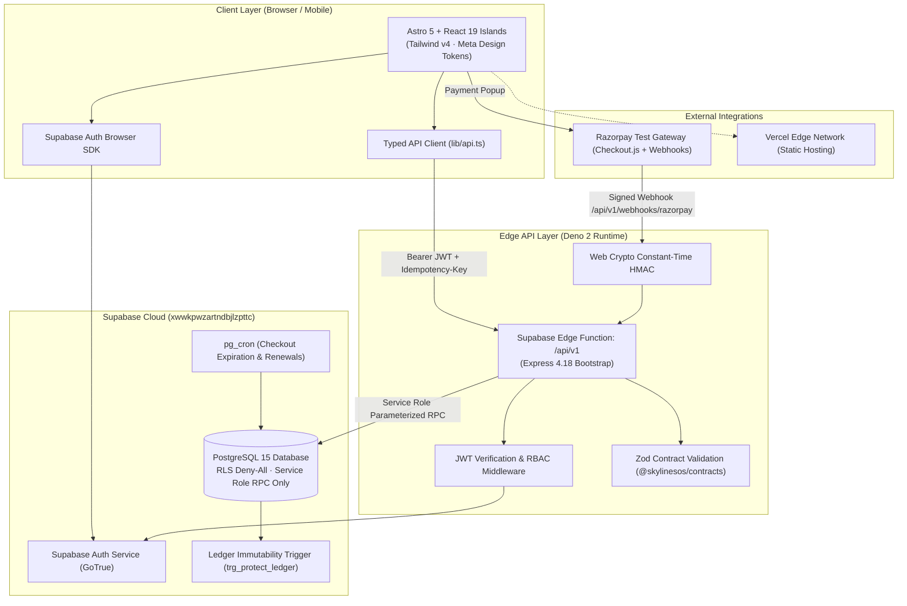
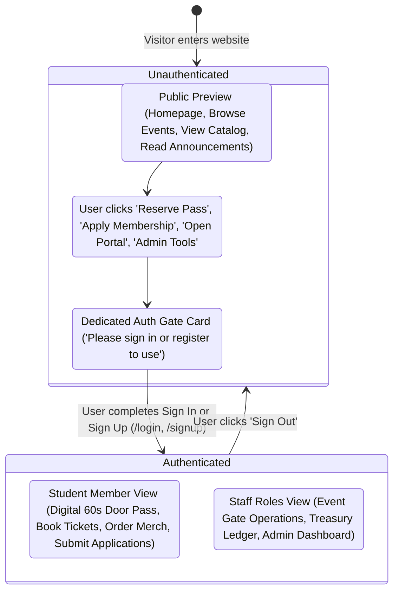
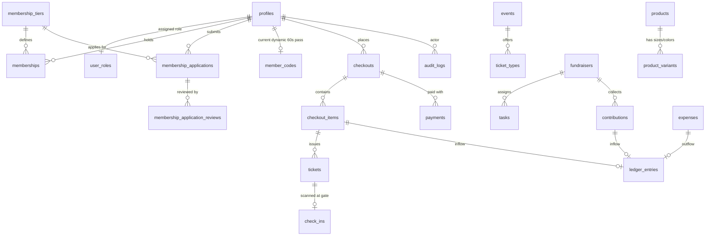

# SkylineSOS — System Architecture & Repository Audit

> **System Name:** SkylineSOS (Student Organization System)  
> **Event:** Odoo × NMIT 2026 Hackathon  
> **Target Production Remote:** `https://github.com/ravitejam2007-code/SkylineSOS.git`  
> **Active Cloud Supabase Project:** `xwwkpwzartndbjlzpttc` (`https://xwwkpwzartndbjlzpttc.supabase.co`)  
> **Branch:** `feature/sos-foundation`  
> **Date:** October 2026  
> **Associated Reference Specifications:**
> - `docs/Student_Organization_System_Complete_Project_Blueprint.md` (Project Blueprint & Strategy)
> - `docs/DESIGN-meta.md` (Meta Commerce Design System & Tokens)
> - `docs/PRD.md` (Product Requirements Document)
> - `docs/TRD.md` (Technical Requirements Document)
> - `docs/api-docs.md` (Complete REST API Reference)
> - `docs/DATABASE_INTEGRITY.md` (Database Invariants & Concurrency Verification)

---

## 1. Executive Summary & Architecture Overview

SkylineSOS is a unified student organization operating system engineered for student clubs and associations to manage memberships, event reservations, door access verification, merchandise sales, announcements, volunteer task workflows, and club treasury with cryptographic and mathematical ledger immutability.

The application follows an **API-Mediated Edge Architecture with Deny-All Database RLS**:
1. **Frontend (`Frontend/`):** An Astro 5 static site with React 19 interactive islands styled with Tailwind CSS v4 using Meta Commerce design tokens (`docs/DESIGN-meta.md`). Configured with `@astrojs/vercel` for zero-maintenance edge deployment.
2. **Backend API (`supabase/functions/api/`):** A centralized Express 4.18 REST API running within a single Supabase Edge Function on the Deno 2 runtime. It provides JWT authentication verification, strict RBAC role authorization, constant-time HMAC webhook verification, database-backed rate limiting, and structured error envelopes.
3. **Database (`supabase/migrations/`):** PostgreSQL 15 hosted on Supabase Cloud (`xwwkpwzartndbjlzpttc`) with 18 relational tables, deny-all RLS security policies revoking direct access from browser roles (`anon`, `authenticated`), 17 atomic business-logic PL/pgSQL RPCs, and automated `pg_cron` jobs.
4. **Shared Contracts (`packages/contracts/`):** Monorepo TypeScript package with Zod validation schemas and shared interface contracts preventing schema drift between frontend and backend.



---

## 2. Actual Repository Structure

```text
E:\projects\SkylineSOS/
├── .agents/
│   └── skills/                             # Supabase & PostgreSQL Best Practices Skills
├── .github/
│   └── workflows/
│       └── ci.yml                          # GitHub Actions CI (Typecheck, Deno, Node Tests)
├── apps/
│   └── web/                                # Monorepo Astro web application shell
├── docs/                                   # Project Documentation & Architecture Specifications
│   ├── .env.example                        # Environment template
│   ├── api-docs.md                         # 100% REST API specifications
│   ├── architecture.md                     # Base system architecture & diagrams
│   ├── ARCHITECTURE.md                     # This file (Consolidated system audit)
│   ├── DATABASE_INTEGRITY.md               # 8 Database invariants and verification
│   ├── demo-data.json                      # 297 Seed records dataset
│   ├── demo-data.md                        # Seeding specification
│   ├── DESIGN-meta.md                      # Meta Commerce design tokens & specifications
│   ├── frontend-api-integration-guide.md   # Typed API client & screen recipes
│   ├── IMPLEMENTATION_CHECKLIST.md         # Detailed module status checklist
│   ├── Navigation-plan.md                  # UI navigation routes & role gates
│   ├── PRD.md                              # Product Requirements Document
│   ├── Student_Organization_System_Complete_Project_Blueprint.md # Master Project Blueprint
│   ├── team-management.md                  # Role permissions matrix
│   └── TRD.md                              # Technical Requirements Document
├── Frontend/                               # Active Production Astro 5 Web Application
│   ├── dist/                               # Production build output
│   ├── public/                             # Public static assets & branding logos
│   ├── src/
│   │   ├── components/
│   │   │   ├── layout/                     # Navbar, UserNavMenu, Footer
│   │   │   ├── scenes/                     # React Island Feature Scenes
│   │   │   │   ├── AdminDashboardScene.tsx # Admin Overview, Applications Review, Catalog
│   │   │   │   ├── AnnouncementsScene.tsx  # Feed, Audience Filters, Broadcast Editor
│   │   │   │   ├── EventOperationsScene.tsx# Gate Check-in (6-digit pass & Crockford codes)
│   │   │   │   ├── EventsScene.tsx         # Curated 2-col events & User Wallet QR passes
│   │   │   │   ├── FundraiserScene.tsx     # Progress bar, Volunteer Task Board, Contributions
│   │   │   │   ├── LoginScene.tsx          # Credentials login & 1-click persona switcher
│   │   │   │   ├── MembershipScene.tsx     # Tier cards, Application form, Walk-up cash dues
│   │   │   │   ├── MerchScene.tsx          # Catalog tabs, Size selector, Real-time stock
│   │   │   │   ├── RoleContext.tsx         # Client-side persona state provider
│   │   │   │   ├── RoleSwitcher.tsx        # Persona switcher toolbar
│   │   │   │   ├── SignUpScene.tsx         # Member registration form
│   │   │   │   ├── StudentPortalScene.tsx  # Dynamic 60s rotating door pass, Active dues
│   │   │   │   └── TreasurerScene.tsx      # Immutable ledger table, Outflows, Reconciliation
│   │   │   └── ui/                         # Badge, Button, Input, Modal, LoadingState primitives
│   │   ├── layouts/                        # BaseLayout.astro
│   │   ├── lib/                            # Client Utilities
│   │   │   ├── api.ts                      # Central typed API client & service layer
│   │   │   ├── auth.ts                     # Supabase Auth browser helpers & demo personas
│   │   │   ├── formatters.ts               # Currency (paise → ₹) and Date formatters
│   │   │   ├── qr.ts                       # Dynamic QR code SVG and Data URL generators
│   │   │   └── supabase.ts                 # Supabase JS client factory
│   │   ├── pages/                          # Astro Static Pages
│   │   │   ├── 404.astro                   # Not found error page
│   │   │   ├── 500.astro                   # Server error recovery page
│   │   │   ├── admin.astro                 # Admin operations console
│   │   │   ├── announcements.astro         # Official club feed
│   │   │   ├── events.astro                # Upcoming organization events & ticket passes
│   │   │   ├── finance.astro               # Permanent redirect to /treasurer
│   │   │   ├── fundraiser.astro            # Campaigns and tasks
│   │   │   ├── index.astro                 # Homepage & hero showcase
│   │   │   ├── login.astro                 # Authentication scene
│   │   │   ├── membership.astro            # Canonical redirect to /memberships
│   │   │   ├── memberships.astro           # Membership tier selection & applications
│   │   │   ├── merch.astro                 # Merchandise catalog
│   │   │   ├── operations.astro            # Staff door check-in terminal
│   │   │   ├── payment/                    # Razorpay success/failure callback handlers
│   │   │   ├── portal.astro                # Student digital ID & door pass
│   │   │   ├── privacy.astro               # Club privacy policy
│   │   │   ├── signup.astro                # Member registration
│   │   │   ├── terms.astro                 # Terms of service
│   │   │   └── treasurer.astro             # Audited ledger & financial dashboard
│   │   └── styles/
│   │       └── global.css                  # Tailwind v4 tokens & Meta commerce theme
│   ├── astro.config.mjs                    # Astro 5 config with @astrojs/vercel adapter
│   ├── package.json                        # Frontend dependencies & scripts
│   └── tsconfig.json                       # Frontend TypeScript configuration
├── packages/
│   └── contracts/                          # Shared Zod Schemas & TypeScript Definitions
│       ├── src/
│       │   ├── actions.ts                  # Action queue item schemas
│       │   ├── announcements.ts            # Announcement draft and publish schemas
│       │   ├── auth.ts                     # Login, session, and role schemas
│       │   ├── checkout.ts                 # Online & staff checkout schemas
│       │   ├── common.ts                   # Base API envelope, error codes, UUID schemas
│       │   ├── events.ts                   # Events and ticket type schemas
│       │   ├── fundraisers.ts              # Campaigns and task schemas
│       │   ├── index.ts                    # Barrel export
│       │   ├── membership.ts               # Tier, application, and review schemas
│       │   ├── merch.ts                    # Product, variant, and order schemas
│       │   └── treasurer.ts                # Ledger, overview, and expense schemas
│       ├── package.json
│       └── tsconfig.json
├── scripts/
│   ├── seed.mjs                            # Replays 297 demo records through RPCs
│   └── verify-integrity.mjs                # Live database invariant reconciliation script
├── seed/
│   └── demo-data.json                      # Seed records for all 18 tables
├── supabase/
│   ├── functions/
│   │   └── api/                            # Express-on-Edge REST API (Deno 2 runtime)
│   │       ├── lib/                        # Edge Helpers (env, hmac, supabaseAdmin)
│   │       ├── middleware/                 # requestId, rbac, zod validate, rateLimit, errors
│   │       ├── routes/                     # Modular route handlers (12 routers, 45+ endpoints)
│   │       ├── deno.json                   # Deno module resolution & npm compatibility
│   │       └── index.ts                    # Express bootstrap & webhook raw body parser
│   ├── migrations/
│   │   ├── 0001_init.sql                   # 18 tables, triggers, ledger immutability
│   │   ├── 0002_rls.sql                    # Strict deny-all RLS policy
│   │   ├── 0003_functions.sql              # 17 atomic business RPCs
│   │   ├── 0004_cron.sql                   # pg_cron scheduled jobs
│   │   └── 0005_fix_checkout_order.sql     # Foreign key ordering fix
│   └── config.toml                         # Supabase local & remote configuration
├── tests/
│   ├── backend.test.mjs                    # Contracts, HMAC, Crockford normalization (24 tests)
│   ├── integrity.test.mjs                  # 8 Database invariants & reconciliation (22 tests)
│   ├── middleware.test.mjs                 # Request ID, RBAC, Rate limits, Error envelopes (13 tests)
│   └── routes.test.mjs                     # Functional routes specifications (20 tests)
├── .env.example                            # Global environment template
├── .gitignore                              # Git exclusion rules
├── .mcp.json                               # MCP Supabase server configuration
├── deno.json                               # Root Deno configuration
├── MEMORY.md                               # Project execution memory & status tracking
└── package.json                            # Workspace root package manifest
```

---

## 3. Technology Stack & Key Architectural Decisions

| Layer | Selected Technology | Rationale & Architectural Decisions |
|---|---|---|
| **Frontend Framework** | **Astro 5.4.1 (`output: 'static'`)** | Ultra-fast static shell with zero JavaScript for static content; island architecture isolates interactive state. |
| **Component Islands** | **React 19.0.0** | Rich interactive state management for checkout drawers, door pass countdowns, and data grids. |
| **Design System** | **Tailwind CSS v4 + Meta Commerce Tokens** | Fully compliant with `docs/DESIGN-meta.md`: Stark white `#ffffff` canvas, pill buttons (`rounded-full`), generous card borders (`rounded-[28px]`), saturated cobalt blue `#0064e0` reserved strictly for buy/pay CTAs, and coral `#f43f5e` accents. |
| **Edge API Runtime** | **Express 4.18 on Deno 2** | Standardized Express routing deployed as a single Supabase Edge Function (`api`). Simplifies development while maintaining sub-millisecond edge cold starts. |
| **Contracts** | **Zod 3.24 + TypeScript 5.7** | Single source of truth for runtime validation and static typings (`@skylinesos/contracts`). Eliminates type drift. |
| **Database** | **PostgreSQL 15 (Supabase Cloud)** | ACID-compliant transactional relational storage. Business invariants (stock limits, ticket caps, ledger equality) enforced strictly in database constraints and triggers. |
| **Security / RLS** | **Deny-All RLS Policy** | Direct browser access to Postgres tables is revoked (`0002_rls.sql`). All queries must flow through the Edge Function using the service role key. |
| **Payment Gateway** | **Razorpay Test Mode** | Online orders initiated server-side; verified via constant-time HMAC-SHA256 (`lib/hmac.ts`) and idempotent webhook deduplication. |
| **Deployment Target** | **Vercel (`@astrojs/vercel`)** | Static output built to `.vercel/output/static` with automatic Edge CDN routing. |

---

## 4. Authentication, Gating & Authorization Architecture

### 4.1 Core Gating Requirement (User Specification)
> *"Without signing in, a user cannot access main works. When an unauthenticated user attempts to use protected features, the website must show a clear 'Please sign in or register to use' barrier/prompt. After signing in or registering, all feature blocks become completely unlocked and usable."*

### 4.2 Three-Tier Access Model



1. **Public Preview Surfaces (No Login Required):**
   - Landing page (`/`)
   - Upcoming Events Catalog (`/events`) — visitors can inspect event details, dates, venues, and ticket tiers.
   - Membership Tiers Showcase (`/memberships`) — visitors can view available club tiers, fees, and perks.
   - Announcements Feed (`/announcements`) — public club broadcasts.
   - Club Privacy & Terms (`/privacy`, `/terms`).

2. **Protected Actions & Tool Blocks (Auth Gate Triggered):**
   - **Student Digital ID & Rotating Door Pass (`/portal`):** Completely blocked if unauthenticated. Renders an interactive `AuthGateCard` with direct `Sign In Now` and `Create Account` actions.
   - **Event Ticket Reservation & Wallet (`/events`):** Unauthenticated users browsing the event cards see the passes. Clicking `Reserve Event Passes` or viewing `My Issued Tickets & QR Passes` prompts sign-in before checkout.
   - **Membership Application (`/memberships`):** Applying for chapter membership requires an authenticated session.
   - **Merchandise Checkout (`/merch`):** Adding items to cart or initiating checkout requires authentication.
   - **Volunteer Task Board (`/fundraiser`):** Claiming tasks or updating status requires volunteer/member authentication.
   - **Restricted Staff Consoles:**
     - Door Gate Scanner (`/operations`) — requires `volunteer`, `door_staff`, or `admin`.
     - Financial Ledger & Float Desk (`/treasurer`) — requires `treasurer` or `admin`.
     - Admin Governance Console (`/admin`) — requires `admin`.

3. **Backend Authorization Enforcement:**
   - Every protected route enforces JWT Bearer token validation via `authenticate` middleware.
   - Role enforcement via `requireRole(...)`:
     ```ts
     app.use('/api/v1/door', authenticate, requireRole('door_staff', 'admin', 'volunteer'));
     app.use('/api/v1/treasurer', authenticate, requireRole('treasurer', 'admin'));
     app.use('/api/v1/admin', authenticate, requireRole('admin'));
     ```
   - Attempting to invoke protected endpoints without a token returns HTTP `401 UNAUTHENTICATED`. Unauthorized roles return HTTP `403 FORBIDDEN`.

---

## 5. Database Schema & Invariant Enforcements

The PostgreSQL database comprises 18 core tables and 17 business RPCs.

### 5.1 Relational Architecture



### 5.2 The 8 System Invariants (`docs/DATABASE_INTEGRITY.md`)
1. **INV-01 (Ledger Immutability):** `ledger_entries` is append-only. Any `UPDATE` or `DELETE` is blocked by database trigger `trg_protect_ledger`. `Inflow - Outflow = Net Movement` holds mathematically at all times.
2. **INV-02 (Event Capacity):** Ticket bookings are bound by `ticket_types.capacity`. Flash crowds cannot oversell capacity due to row locks in `fn_create_checkout`.
3. **INV-03 (Single-Use Gate Passes):** Each issued ticket can only be checked in once. Second scan raises `TICKET_ALREADY_CHECKED_IN` preserving original timestamp.
4. **INV-04 (Stock Integrity):** Available merchandise variant stock is strictly `stock_on_hand - reserved`. Check constraint `reserved <= stock_on_hand` prevents overselling.
5. **INV-05 (Webhook Deduplication):** Payment webhooks deduplicate on `provider_event_id`. Duplicate fulfilment calls are idempotent no-ops.
6. **INV-06 (Segregation of Duties):** Submitters cannot approve their own expenses (`SELF_APPROVAL_FORBIDDEN`). Approved status is required before marking an expense paid.
7. **INV-07 (Dynamic Code TTL):** Dynamic member codes expire strictly after 60 seconds.
8. **INV-08 (Zero Secrets & Last Admin Protection):** Passwords and tokens are never written to audit logs. Demoting the sole remaining administrator is blocked by SQL check.

---

## 6. Baseline Test & Verification Results

| Test Category | Suite File | Total Tests | Pass | Fail | Execution Time |
|---|---|---|---|---|---|
| **Contract & Webhook Security** | `tests/backend.test.mjs` | 24 | 24 | 0 | 114ms |
| **Database Invariants & Integrity** | `tests/integrity.test.mjs` | 22 | 22 | 0 | 48ms |
| **Middleware & RBAC Enforcement** | `tests/middleware.test.mjs` | 13 | 13 | 0 | 56ms |
| **Functional Routes Specifications** | `tests/routes.test.mjs` | 20 | 20 | 0 | 62ms |
| **Total Test Suite (`npm test`)** | **All 4 Suites** | **79** | **79** | **0** | **3.62s** |

### Additional Build Verifications:
- **Contract Schemas:** `npm run typecheck` (`@skylinesos/contracts`) compiled cleanly with 0 errors.
- **Frontend Build:** `npm run build` in `Frontend/` compiled all 20 static pages via `@astrojs/vercel` into `.vercel/output/static` in 4.90s with 0 errors.
- **Static Type Check:** `astro check` reported 16 type discrepancies in components where legacy contracts had minor field name deviations (e.g. `ticket_type` vs `tier`). These are documented in `docs/IMPLEMENTATION_CHECKLIST.md`.
